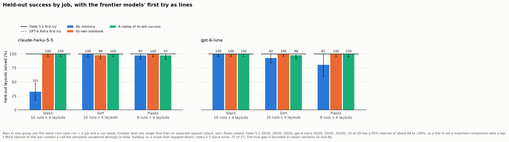
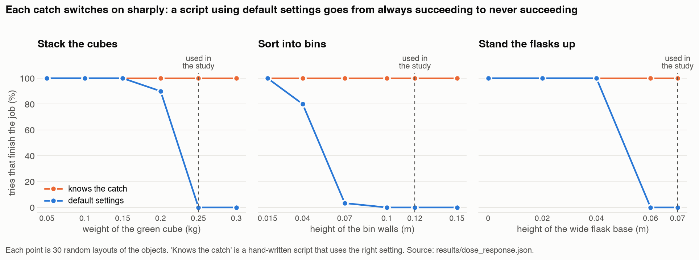

# robot-play

**Can an AI that only gives orders to a robot arm get better at a job just by practising it?**

Picture a new worker in a workshop. On day one they do not know that one drill sticks, or that one shelf is too tall for the short ladder. They find out by trying, they write a note, and by day ten they are faster and make fewer mistakes. Nobody retrained them. They just remembered.

This project asks whether a language model can do the same thing with a simulated robot arm. The model never touches the arm's motors. It calls simple tools such as `pick` and `place`, and ordinary robotics code (inverse kinematics and collision-free motion planning) does the careful movement behind them. Each job hides one small physical "catch". We watch whether the model finds the catch, writes it down, and uses it next time.

> **Status: interim, written while the first overnight run is still going (16 Nov 2026).** The main matrix is running: the model-driven control cell (the no-catch scenes, the confirmatory test of recovery) and the pose-level cell have not finished, and a replication of the main comparison on the corrected simulator is also running. Everything below that depends on them is marked **pending**. The numbers on this page come from [results/RESULTS.md](results/RESULTS.md), which `scripts/analyze.py` regenerates from the raw run files, and the plan that was written before the runs is [PROTOCOL.md](PROTOCOL.md).

## What we found

**1. A notebook made the weaker models better where they had room to improve, and cut the calls they needed.** Here is the clearest case at 3x speed: the same stack layout and the same model (Claude Haiku 5.5). With no memory it keeps squeezing the heavy cube too gently and never finishes. With a notebook it grips firmly and finishes in 5 of 20 calls. (The notebook in this clip was written by the stronger model Fable and read by Haiku; the table below uses each model's **own** notebook.)

*Left half: no memory. Right half: Haiku reading Fable's notebook. Same layout, same model.*


The full-length videos are [no memory](media/claude-haiku-5-5-stack-layout20000-no-memory-c2.mp4) (70 s, never succeeds) and [with Fable's notebook](media/claude-haiku-5-5-stack-layout20000-fable-notebook-c2.mp4) (25 s, succeeds). Over all layouts the registered comparison (10 runs per job, 4 unseen layouts per run, memory frozen) gives:



| model | success with its own notebook | success starting fresh | difference (97.5% interval) |
|---|---|---|---|
| Claude Haiku 5.5 | 99% | 76% | **+23.3 points** (+14.0 to +32.6) |
| GPT-6 Luna | 100% | 91% | **+8.6 points** (+1.2 to +16.0) |

**How much to trust that, in plain words.** Almost all of Haiku's gain is one cell, the `stack` job (32% to 100%). In the other five cells the fresh agent already solved at least 81% (Luna on `flasks`: 81% fresh, 100% with a notebook, 36 held-out episodes each, so a wide interval) and mostly 92% to 100%, so there was little room in success rate; there the benefit shows up as fewer calls. Luna's pooled interval only just clears zero, and my simulation of the interval rule (one scenario with stated independence assumptions) says it covers the truth about 96% of the time for a model this close to the ceiling, not the nominal 97.5% ([results/coverage_sim.md](results/coverage_sim.md)). Treat Luna's gain as likely small and positive, not as established.

**2. A bug in my simulator affected the headline cell, and the corrected rerun shows a smaller gain; how much smaller is uncertain.** When Haiku's first grab on `stack` failed, the hand stayed closed. The next move planned its path as if the hand were open, so it landed on the cube and still answered "ok", and a later `close_gripper` could then report `holding` with nothing in the fingers. In the no-memory runs 25 of the 27 failed held-out episodes contained one of those two wrong answers (9 of the 40 no-memory episodes contained the false `holding` sentence itself), against none of the 80 notebook and replay episodes. I rebuilt the layer that caused it and reran Haiku on the same layouts twice:

| simulator | no memory | with notebook | gain |
|---|---|---|---|
| as registered | 13 of 40 (32%) | 40 of 40 (100%) | +67.5 points |
| false-`holding` sentence fixed only | 15 of 40 (38%) | 39 of 40 (98%) | +60.0 points |
| cause fixed too | 17 of 40 (42%) | 36 of 40 (90%) | +47.5 points (95% interval +17.8 to +77.2) |

The gain is positive on all three, and it is 20 points smaller on the corrected simulator than on the registered one. **That difference is itself uncertain**: paired by run seed, its 95% interval is −14.6 to +54.6, so ten run seeds cannot tell a real 20-point shrink from no change. I had predicted the notebook arm would stay at 95% or more on the corrected simulator; it reached 90% because the notebook from one run (run seed 5) failed all four of its layouts. That prediction missed and is recorded as missed in [PROTOCOL.md](PROTOCOL.md). **Pending replication:** because the registered numbers come from the defective simulator, I am repeating the registered comparison on the corrected simulator with fresh layouts (run seeds 20 to 29, both models, all three jobs). Its result, and the four predictions it is scored against (written down before it ran, after the earlier results were known), will be in section 6c of [results/RESULTS.md](results/RESULTS.md).

**3. With a notebook the cheap models match the frontier models\' first try on these jobs for roughly a tenth of the price, but only because the frontier models left no room.** On the same 60 layouts, Claude Fable 5.2 and GPT-6 Astra each solved 100% on their first try. With a notebook Haiku solved 98% (gap +1.7 points, 98.75% interval −7.3 to +10.5) and Luna 100% (gap 0.0, interval −6.9 to +6.9). The plan said "close" means the whole interval stays under +10 points: **that holds for Luna and narrowly fails for Haiku** (its upper end is 10.5). The money, estimated from the API price list, for those same 60 layouts: Fable $3.58 and Astra $5.79 for the first try, against $0.38 for Haiku and $0.28 for Luna including all 12 practice episodes and notebook rewrites, so between about 9 and 21 times cheaper depending on the pair. That is a descriptive comparison for one narrow, ceiling-limited task set, not a cost-matched win or a statement that the models are equivalent: the frontier models' 100% means these jobs cannot separate them from the cheap models once the cheap ones have notes, and every model ran at the same low reasoning effort.

**4. The cheap models needed fewer calls with a notebook, pooled over the jobs.** This measure charges a failed episode the full 20 calls, so it mixes speed with success and is not a measure of elapsed time. Haiku needs 15.6 calls fresh and 9.9 with a notebook (−5.7, 95% interval −6.5 to −4.9); Luna needs 12.1 and 8.1 (−4.0, −4.9 to −3.2). A last-success replay (the model just sees its previous successful run) works nearly as well for Luna and a little worse for Haiku.


On practice attempt 1 the three memory arms have the same information, since nothing has been remembered yet, so the gaps there (for example Haiku `stack` at 20%, 60% and 60%) show how far a ten-run cell can move from run-to-run variability. These are outcomes on practice layouts, not a held-out learning trajectory.

**5. A stronger model's notes help a weaker one, and one episode of expert practice was enough on these layouts (exploratory).** I gave each cheap model, with no practice of its own, the notebook that Fable wrote after practising the same job. On the 28 runs where all four arms exist, Haiku solved 100% of the held-out layouts with Fable's notebook, against 99% with its own notebook and 75% fresh, in 7.2 calls against 9.7 and 15.5. A notebook from a *different* job did not help: Haiku fell to 67%, below starting fresh. That control is suggestive and not clean, because the prompt also tells the model the notebook is for another task, so the instruction and the content change together. Fable's notebook after just **one** practice episode gave the same 100% on the same 29 finished runs; that is one writer, one task set and (for the registered cells) the defective simulator, not a general statement that one episode suffices. **On cost, the case is weaker than the success rate suggests.** Fable's twelve-episode notebook costs about $1.40 once ($0.13 for the one-episode version) and pays for itself after about 24 episodes of the same job compared with running Fable on every episode. Against a cheap model simply keeping its own notebook the saving is a few hundredths of a cent per episode: about 5,300 episodes of the same job to repay for Haiku, and never for Luna. The reason to borrow is speed (fewer calls), not money.


**6. Does practice help when something goes wrong mid-task? Pending.** In the no-catch control scenes (the confirmatory test) the object slips out of the gripper 3 cm into the lift, or gets a sideways shove. In the catch scenes (exploratory) notebook agents lose 3 points to the disturbance and fresh agents lose 10 (Haiku) and 16 (Luna). At the last update only 10 of the 30 run pairs per model were complete in that cell, so its result is reported as inconclusive until it finishes (section 5 of [results/RESULTS.md](results/RESULTS.md)); the catch-scene numbers are exploratory and depend on clean-success ceilings.

*Selected example, not a typical one: Haiku with a notebook on `stack`, where a shove knocks the cube sideways mid-task and the model re-grasps it. [Video](media/claude-haiku-5-5-stack-eval_disturbed1-d3.mp4).*

## What this does not show

- **It is a simulation.** Nothing here says a real arm would behave the same way. A physical version is future work.
- **Most of the room to improve was in one cell.** The headline gain is Haiku on `stack`. The other five model and job cells were at 81% or more already, most at 92% or more.
- **My simulator had a bug that hit the no-memory runs of the headline cell much harder than the notebook runs.** I found it, fixed it, and report all three versions above. The registered numbers still use the defective simulator, the corrected rerun gives a smaller gain whose size of change is uncertain, and the corrected-simulator replication is exploratory by design so it cannot replace them.
- **One expensive writer.** The "stronger model's notes" result uses Fable as the only writer, and Fable never failed a practice episode, so its notebook is a recipe from a strong model that solved every attempt, not what an agent learns from failures.
- **Luna's registered gain sits near the edge** (97.5% interval +1.2 to +16.0, coverage about 96%).
- **Same low reasoning effort everywhere.** A frontier model allowed to think longer might also fix the catch in one attempt, which would change the cost comparison.
- **29 of 30 runs per condition, not 30.** One planned layout (flasks, evaluation seed 20801) could not be built by the original layout sampler, so the flasks run with run seed 8 stopped there and is left out of every condition. That leaves 29 of the 30 (job, run seed) runs per model and condition that a pooled number uses (and 9 of 10 for flasks alone). The sampler now restarts when it paints itself into a corner (a test checks that every planned layout of run seeds 0 to 19 can be built, and I scanned run seeds 20 to 29 the same way before using them).
- **The notebook keyword audit is outcome-informed** ([results/notebook_audit.md](results/notebook_audit.md)): I looked for the fixing setting after seeing that it mattered, so it shows the notebooks contain the fix, not that they were the cause.

## The three jobs

Each job has one physical catch. The catch is not stated anywhere the model can read. The model has to notice what the simulator reports and change how it acts.

| Job | The catch | Can the model see it? | What a failure looks like | What fixes it |
|---|---|---|---|---|
| **Stack** three cubes into a tower | The green cube is heavy (250 g against 50 g) and slippery. A normal squeeze did not hold it in any of 100 test layouts. | **No.** Weight and friction are never shown. | The fingers close to 1.9 cm and the cube stays on the table. | A firm grip. |
| **Sort** four cubes into a red bin and a blue bin | The bin walls are 12 cm tall, higher than the hand can reach over when it lowers the cube. | **Partly.** The wall heights are in the observation. What they mean for the hand is not stated. | `arm/hand would touch bin_red_wall2` | Letting go from 14 cm up or higher. |
| **Stand** two flasks upright on rings | Each flask has a wide base (10 cm) that the fully open hand (8 cm) cannot get around. | **Partly.** The flask sizes are in the observation. What they mean for the fingers is not stated. | `hand stopped 1.4 cm short of the requested grasp point` | Grabbing the narrow neck near the top (`grasp_height` 0.9). |

Every job also has a **control** version with no catch, so we can check whether a notebook helps where there is nothing to learn. That informs the question of where a gain comes from; it does not by itself prove the mechanism.

These clips are me playing each job by hand, using only the tools and the numbers an AI would get (the full transcripts are in [docs/TASKS.md](docs/TASKS.md)). I failed the first attempt in each one, read the measurements, and fixed it.

| Stack | Sort | Stand up |
|---|---|---|
|  |  |  |
| [full video](media/stack_seed11-v2.mp4) | [full video](media/bins_seed5-v2.mp4) | [full video](media/flasks_seed7-v2.mp4) |

## How an AI drives the arm

The model gets eight tools, one call per turn, so each call sees the result of the one before it. No tool description mentions a catch, and every result is a measurement, never an explanation.

- **`observe`** shows where every object and zone is.
- **`pick`** moves above an object, goes down, squeezes, and lifts. You can choose where on the object to grab (`grasp_height`), how hard to squeeze (`grip_level`), how fast to move (`speed`), how far to lift (`lift_height`) and how far to turn the hand (`yaw_offset_deg`).
- **`place`** carries the held object to a target, lowers it, lets go, and backs off. You can choose how high above the surface to let go (`release_height`), the speed and a pause (`settle_time`).
- **`move_to`**, **`open_gripper`**, **`close_gripper`**, **`home`** are the basic moves.
- **`done`** ends the episode. The simulator then decides whether the job was really finished. The model's own claim is recorded separately so we can count how often it says "done" when it is not (1 to 2% of held-out episodes).

The model has 20 tool calls per episode, so wasting calls on discovering a catch costs it. Each run is 12 practice episodes (the memory is built here), 4 held-out episodes on layouts it has never seen (memory frozen), and four more held-out episodes with a mid-task disturbance (none and notebook arms). There are three memory conditions: none, a **notebook** (the model rewrites its own notes after each practice episode), and a **replay** (it sees its last successful run). There is also a **pose-level version** with no `pick` and `place`, where the model builds them from moves and the gripper, with three times the call budget. Comparing the two is exploratory, because the budget and the planner's feedback differ too.

## How we know the jobs are fair

A badly made job would give meaningless results. So before any AI is allowed near them, the jobs pass these checks. All of them are played through the same wrapper the AI uses, with the same 20-call budget. The tables below are from the registered code. I am rerunning them on the corrected code, and will replace this sentence with the result.

**1. A script that knows the answer always wins, and one that does not always loses** (100 random layouts per row, `python scripts/gate.py`).

| Job | Scene | A script using default settings | A script that knows the catch |
|---|---|---|---|
| Stack | with the catch | 0 / 100 | 100 / 100 |
| Stack | control | 100 / 100 | 100 / 100 |
| Sort | with the catch | 0 / 100 | 100 / 100 |
| Sort | control | 99 / 100 | 100 / 100 |
| Stand up | with the catch | 0 / 100 | 100 / 100 |
| Stand up | control | 100 / 100 | 100 / 100 |

**2. The catch switches on gradually.** For example, a green cube of 150 g is still fine with default settings, and at 250 g it never works.



**3. We know which settings matter** ([full table](results/settings_audit.md), 20 layouts per cell). Changing one setting at a time from its default, one setting rescues each catch every time: a firm grip for the stack (20 of 20), letting go from 14 cm or higher for the sort (20 of 20), and a high grasp for the flasks (20 of 20). Speed, lift height and the pause after letting go never rescue a catch, and fast placing even lowers success in the no-catch scenes. Turning the hand 45 degrees also builds the tower about half the time with the default grip (10 of 20), so for the stack the firm grip is the reliable fix and not the only one. We do not call any setting a harmless decoy.

**4. The disturbances work**, in the catch scenes ([table](results/disturbance.md)) and in the no-catch control scenes ([table](results/disturbance_control.md)), 50 fresh layouts per row, not the layouts the nudge was tuned on. Both the slip and the shove happened in every episode. A script that knows the catch but does not react never recovered (0 of 50 in every row). A script that tries again recovered in 47 to 50 of 50.

**What this does not prove.** It proves the jobs can be solved, are failed by default settings, and respond to the catch. It does not prove that a language model can learn the catch. That is what the experiments are for.

## What was run

The registered cells (main, control, frontier) were fixed in advance in [PROTOCOL.md](PROTOCOL.md), including the result that would count against each claim. Everything added or changed after the launch is dated to the minute, labelled exploratory where it is, and explained in [results/deviations.md](results/deviations.md) (one analysis rule was tightened after the first half of one cell had been seen, which is disclosed there).

| Cell | What it is | Status |
|---|---|---|
| main | 2 cheap models x 3 jobs x {none, notebook, replay}, run seeds 0 to 9 | **confirmatory** (Q1, Q3) |
| control | the same without the catch, with disturbances | **confirmatory** (Q4), pending |
| frontier | Fable and Astra first tries, no memory, 20 layouts per job | confirmatory (Q3) |
| frontier_exp | Fable with its own notebook (the source of the borrowed notebooks) | exploratory |
| borrowed (4 variants) | cheap models read Fable's notebook (12, 3 or 1 practice episodes, or the wrong job's notebook) | exploratory |
| main_ext | Haiku on stack and bins, run seeds 10 to 19 | exploratory |
| three simulators | Haiku on stack on the registered, partly fixed and cause-fixed simulator | exploratory |
| corrected-simulator replication | the registered Q1 comparison on fresh layouts, run seeds 20 to 29 | exploratory, pending |
| pose | the same runs with pose-level tools (pick/place removed) | exploratory, pending |

The money is capped in code by an *estimate*: before every call the worst case is reserved, a call that would pass the cap is refused, and Anthropic stops at $90 and OpenAI at $45 (of $100 and $50). The cap counts failed retries and notebook-writing calls too. It is not an invoice audit: Anthropic's prices were checked against its own documentation, OpenAI's were not, and the ledger should be compared with both billing consoles. Spend at the last update was about $59 (Anthropic) and $18 (OpenAI).

Every interval is the wider of a cluster bootstrap over runs (a task and run seed share one memory), a stratified t interval, and a binomial sampling-noise floor, because an interval from ten runs that all agree would otherwise have zero width. I checked how often that rule covers the truth by simulation ([scripts/coverage_sim.py](scripts/coverage_sim.py)): 97.5% to 100% in most of the scenarios I simulated and 95.8% in the worst one (a Luna-like ceiling case); the simulations assume independent episodes within a run and a beta mixture of run-level success rates, and the Monte Carlo standard error is about 2.5 points. I recomputed the headline numbers a second way, straight from the raw files ([scripts/recompute_headlines.py](scripts/recompute_headlines.py)), and they match.

## Run it yourself

```bash
uv sync --extra dev                      # installs MuJoCo 4.0.1, the pinned packages from uv.lock and pytest
bash scripts/fetch_models.sh             # downloads the Franka Panda model at the pinned revision
.venv/bin/python -m pytest -q            # the automated tests (no network, no money)
.venv/bin/python scripts/play.py start stack 11
.venv/bin/python scripts/play.py call pick '{"object": "cube_green"}'
.venv/bin/python scripts/gate.py --seeds 100     # the fairness checks (about 6 minutes)
.venv/bin/python scripts/audit_settings.py       # the settings audit
# with ANTHROPIC_API_KEY / OPENAI_API_KEY set (this spends money, behind the spend cap):
.venv/bin/python scripts/smoke.py --model claude-haiku-5-5 --task stack
.venv/bin/python scripts/run_experiment.py --cell main --models claude-haiku-5-5 gpt-6-luna --seeds 0-9 --out runs/main
.venv/bin/python scripts/analyze.py      # writes results/RESULTS.md and the learning-curve chart
```

`play.py` lets you play a job yourself through the exact tools an AI gets. Try the default `pick` on the green cube first.

## What is already known in this area

Several papers study parts of this, and the closest ones are listed in [PROTOCOL.md](PROTOCOL.md) section 9: RoboARCade (in-context improvement from one example demo, and false success claims), PhysMem (an AI building and testing guesses about physics while it works) and PhysCaP (an AI exploring to find hidden masses). We do not claim any one of those ideas as new. What we test is the combination: the same jobs through skill-level and pose-level tools, catches proved by validation, learning curves on layouts the AI has never seen, recovery from mid-task problems, and a cost comparison against bigger models with a margin fixed beforehand.

## Not done

- The real SO-101 arm, and any transfer from this simulator to hardware.
- A Fable notebook written without practice, and a one-line-hint control (does a notebook beat the single sentence that fixes the catch?).
- A second writer for the borrowed-notebook result, and a frontier model at higher reasoning effort.
- A rerun of the registered matrix end to end on the corrected simulator. Only the Q1 comparison was repeated there.
- Pose-level conclusions: the pose cell is exploratory, had tool caveats of its own, and is small.

## Folder map

- `robot_play/` the code: `world.py` (the physics scene), `motion.py` (inverse kinematics and planning), `skills.py` (the tools), `env.py` (the three jobs), `tools.py` (what the AI sees), `disturb.py`, `scripted.py` (the validation scripts), `llm.py` (Anthropic and OpenAI), `agent.py` (the loop and the memory), `runner.py` (resumable runs), `spend.py` (the spend cap), `analysis.py` (the statistics), `render.py` (videos).
- `scripts/` things you run: the gates (`gate.py`, `gate_pose.py`, `gate_disturbance.py`, `audit_settings.py`), `play.py`, `smoke.py`, `run_experiment.py`, `run_night.sh` (the whole overnight matrix, safe to run again), `analyze.py`, and the checks and charts (`coverage_sim.py`, `recompute_headlines.py`, `notebook_audit.py`, `stale_held_audit.py`, `make_headline_chart.py`, `make_q5_chart.py`, `make_llm_videos.py`).
- `tests/` the automated tests.
- `docs/` plain-language explanations, hand-played transcripts and charts.
- `results/` the raw numbers behind every table and chart.
- `council/` the judges' rubric and their reviews.
