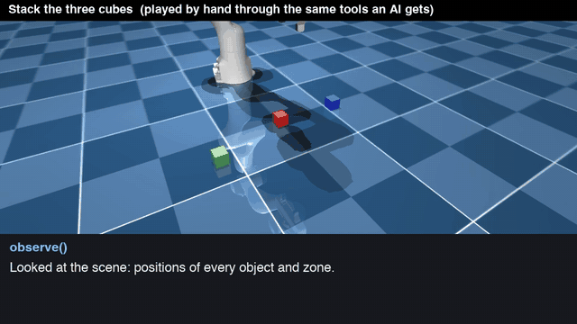
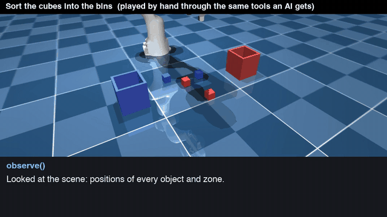
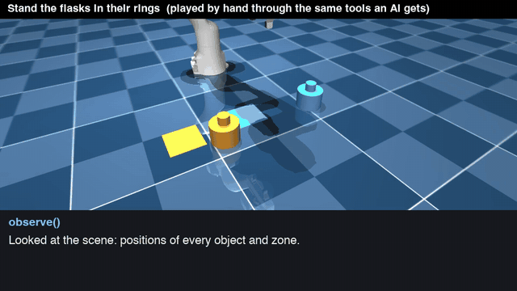

# robot-play

**Can an AI that only gives orders to a robot arm get better at a job just by practising it?**

Picture a new worker in a workshop. On day one they do not know that one drill sticks, or that one shelf is too tall for the short ladder. They find out by trying, they write a note, and by day ten they are faster and make fewer mistakes. Nobody retrained them. They just remembered.

This project asks whether a language model can do the same thing with a simulated robot arm. The model never touches the arm's motors. It calls simple tools such as `pick` and `place`, and ordinary robotics code (inverse kinematics and collision-free motion planning) does the careful movement behind them. Each job hides one small physical "catch". We watch whether the model finds the catch, writes it down, and uses it next time.

> **Status: all cells have run.** The registered matrix ended on 17 Nov at 01:26 with one prespecified-layout exclusion (a flasks layout the original sampler cannot build; see "What this does not show"); the exploratory cells ended later that night. Every number below comes from [results/RESULTS.md](results/RESULTS.md), which `scripts/analyze.py` regenerates from the raw run files in [data/](data/README.md) (8.3 MB, no network or money needed). The plan written before the runs is [PROTOCOL.md](PROTOCOL.md); what went wrong or changed is in [results/deviations.md](results/deviations.md) (six entries); [results/code_versions.md](results/code_versions.md) says which code produced which folder. Only rows 1, 5 and 6 below are registered (confirmatory); everything else is exploratory.

## The results on one screen

| | What was asked | What happened | Status |
|---|---|---|---|
| 1 | Does a self-written notebook help a cheap model, against starting fresh? | **Yes where there was room.** Haiku +23.3 points (97.5% interval +14.0 to +32.6), Luna +8.6 (+1.2 to +16.0). Nearly all of Haiku's gain is one job, `stack` (32% to 100%). | registered |
| 2 | Does the same hold on a corrected simulator with fresh layouts? | **Yes.** Haiku +21.7 (+14.1 to +29.2), Luna +9.2 (+3.6 to +14.7); four of four predictions met. | exploratory replication |
| 3 | What does the notebook carry that a one-line note does not? | **Less than it looks.** A sentence naming the fix matches the notebook (both 100%). A note that lists the four adjustable settings reaches 92% and, on fresh layouts, 98%, against about 50% fresh on Haiku `stack`. Taking it apart: the names do most of the work (names against "change how you call it", pooled +27.5 points, +16.1 to +38.9), the instruction some, the frame little. Four of my predictions in this series missed (H2, H3, W1, W2); the replication's six were met, two of them on the threshold. | exploratory |
| 4 | Do notes from a stronger writer work with no practice? | **Yes, on these jobs, where a one-line sentence naming the fix does just as well** (so this shows the notes contain the answer, not that writers differ). Fable's and Sonnet's notebooks let Haiku skip practice (Sonnet's: 100% against 71% fresh). A notebook written with no practice did not mention the fix by the keyword audit (65%). | exploratory |
| 5 | Can a cheap model with a notebook match frontier models? | **A ceiling result.** Fable and Astra solved 60 of 60 first tries, so the jobs cannot separate them from anything that also solves them. | registered |
| 6 | Does practice help recovery from a mid-task disturbance? | **No evidence of an effect** (Haiku −2.6 points, −9.8 to +4.6; Luna +0.9, −6.3 to +8.1). The test had little room: fresh agents already kept 94% and 96%. | registered |
| 7 | Can the models do the jobs without `pick` and `place`? | **Yes, a notebook helped Luna clearly (50% to 86%) and Haiku by an amount that cannot be told from zero.** Nine runs per model, on the registered simulator whose closed-hand defect sits in the tools these runs use. | exploratory |

Findings 1 to 4 are explained below. Rows 5 to 7 and the Fable-notebook results are in [docs/other-findings.md](docs/other-findings.md).

## What we found

**1. A notebook made the weaker models better where they had room to improve, and cut the calls they needed.** The registered comparison (10 runs per job, 4 unseen layouts per run, memory frozen, each model using its **own** notebook) gives:


| model | success with its own notebook | success starting fresh | difference (97.5% interval) |
|---|---|---|---|
| Claude Haiku 5.5 | 99% | 76% | **+23.3 points** (+14.0 to +32.6) |
| GPT-6 Luna | 100% | 91% | **+8.6 points** (+1.2 to +16.0) |

**How much to trust that.** Almost all of Haiku's gain is one cell, the `stack` job (32% to 100%). In the other five cells the fresh agent already solved at least 81% (Luna on `flasks`: 81% fresh, 100% with a notebook, 36 episodes each, so a wide interval) and mostly 92% to 100%, so there was little room in success rate; there the benefit shows up as fewer calls (Haiku 15.6 calls fresh, 9.9 with a notebook; Luna 12.1 and 8.1). Luna's pooled interval only just clears zero, and my simulation of the interval rule says it covers the truth about 96% of the time for a model this close to the ceiling, not the nominal 97.5% ([results/coverage_sim.md](results/coverage_sim.md)).

**2. A bug in my simulator touched the headline cell, but the same comparison on the corrected simulator with fresh layouts shows the same gain.** When Haiku's first grab on `stack` failed, the hand stayed closed. The next move planned its path as if the hand were open, so it landed on the cube and still answered "ok", and a later `close_gripper` could report `holding` with nothing in the fingers. In the no-memory runs 25 of the 27 failed held-out episodes contained one of those two wrong answers, against none of the 80 notebook and replay episodes. I rebuilt the layer that caused it and repeated the registered comparison on **fresh layouts** (run seeds 20 to 29, both models, all three jobs, 2,400 episodes, [results/RESULTS.md](results/RESULTS.md) section 6c), with four predictions written down before it ran:

| corrected simulator, fresh layouts | with notebook | no memory | difference (95% interval) |
|---|---|---|---|
| Haiku, all three jobs | 100% | 78% | **+21.7 points** (+14.1 to +29.2) |
| Haiku, `stack` only | 100% | 50% | +50.0 points (+31.1 to +68.9) |
| Luna, all three jobs | 100% | 91% | **+9.2 points** (+3.6 to +14.7) |

All four predictions were met (they were written after the earlier results were known, so they are predictions about a replication, not independent forecasts), and the registered pooled gains (+23.3 and +8.6) sit inside these intervals. The false-`holding` and short-move symptoms are zero in all 480 held-out episodes of the replication. **What the bug did and did not do:** the qualitative gain replicated on corrected code; the exact size of the original effect is uncertain. On the same ten run seeds three simulators gave Haiku `stack` gains of +67.5 (as registered), +60.0 (symptom fixed) and +47.5 points (cause fixed, interval +17.8 to +77.2). That 20-point drop is **not** shown to be the bug's doing: its paired interval is −14.6 to +54.6, the no-memory arm only moved from 13 to 15 to 17 of 40 (inside rerun noise), and half of the drop is one notebook run (run seed 5) that got 0 of 12 in practice and wrote "pick fails. Do not use pick" (a prediction that the notebook arm would stay at 95% or more therefore missed: 90%, recorded as missed in [PROTOCOL.md](PROTOCOL.md)). The registered `stack` gain (+67.5) may be a little high, since fresh layouts gave +50.0.

**3. What a short note can do: a list of the adjustable settings recovers most of the notebook's gain on `stack` (exploratory; I registered predictions before each step, and four of them missed).** A reader's first question is what a notebook actually adds. I ran the same unseen layouts with no practice and one fixed text in the memory slot (10 runs, 4 layouts each, so 40 episodes per cell; run seeds 20 to 29, and later fresh run seeds 30 to 39). The texts are built from three parts: a **frame** ("Defaults do not suit every object or surface."), an **instruction** ("When a pick or place fails or is refused, read the message and change the settings one at a time instead of repeating the same call.") and the **names** of the four adjustable settings ("grip_level, grasp_height, release_height, speed"). The **generic sentence** is all three; the **naming sentence** says which setting fixes the job ("Pick the green cube with grip_level firm."); the **inert sentence** names no setting and gives no advice about them ("Every object in this scene can be handled with the tools you have, one after another. When a call fails or is refused, read the message and look at the scene again before you carry on, and call done only once the job really is finished."). Except in the "own label" rows, every text sits under **one neutral label** ("NOTES FOR THIS TASK"). Held-out success:

| what the model reads (no practice unless stated) | Haiku, `stack` | Haiku, all three jobs | Luna, all three jobs |
|---|---|---|---|
| nothing | 50% | 78% | 91% |
| the inert sentence | 40% | 75% | 86% |
| the generic sentence (frame, instruction and names) | **92%** | 92% | 94% |
| the naming sentence | **100%** | 100% | 100% |
| Fable's notebook written with zero practice (own label) | 65% | 87% | 89% |
| its own notebook after 12 practice episodes (own label) | **100%** | 100% | 100% |

**Taking the generic sentence apart** (Haiku, `stack` only; the first split was registered and pushed before it ran, and I then repeated it on fresh layouts with two more wordings, also registered and pushed first). Each text keeps the frame:

| text under the neutral label | run seeds 20 to 29 | run seeds 30 to 39 (fresh) |
|---|---|---|
| nothing | 50% | 48% |
| the inert sentence | 40% | 42% |
| the frame, then "When a pick or place fails or is refused, read the message before you carry on." (**frame only**) | 50% | 65% |
| the frame, then "...read the message and change how you call it, one thing at a time, instead of repeating the same call." (**instruction, no names, no word "settings"**) | 70% | 65% |
| the frame, then "...read the message and change the settings one at a time instead of repeating the same call." (**instruction with "settings", no names**) | | 78% |
| the frame, then "The adjustable settings are grip_level, grasp_height, release_height and speed." (**names, no instruction**) | **92%** | **98%** |
| the frame, then "When a pick or place fails or is refused, read the message. The adjustable settings are grip_level, grasp_height, release_height and speed." (**names, with "read the message"**) | | 88% |
| the generic sentence | 92% | 98% |

- **One sentence naming the fix is as good as the notebook (H1, met, at a 100% ceiling).** The difference from the model's own notebook is 0.0 points (Haiku pooled, interval −2.3 to +2.3), in fewer calls (7.5 against 9.8). A ceiling says "sufficient to match", not that the notebook holds nothing else: with its own notebook Haiku did not set the firm grip in 12 of 40 `stack` episodes and solved those 12 by turning the hand 45 degrees together with slow speed ([results/firm_grip_audit.md](results/firm_grip_audit.md); the one-setting-at-a-time audit found the turn alone works in only 10 of 20 scripted layouts).
- **A note that lists the settings and tells the reader to change them gets most of the way (H2, MISSED).** I predicted at most 60% on `stack` for the generic sentence; it reached 90% under the operator label, 92% under the neutral one and 98% on the fresh layouts. The rule I wrote in advance says the headline is weakened: a large part of the notebook's gain on `stack` is reproduced by a sentence that does not say which setting to change. In the logs Haiku set the firm grip in 21 of 40 `stack` episodes with no memory, 36 of 40 with the generic sentence (35 under the operator label) and 40 of 40 with the naming sentence.
- **Which part does the work (v1.10: W1 and W2 MISSED, W3 met; v1.11: R0 to R5 all met, R2 and R4 exactly on their thresholds).** I guessed that the instruction to vary settings mattered most. The opposite came out twice. The frame and the four names, with no instruction, reached 92% and then 98%, the same as the full sentence. The instruction alone ("change how you call it") stayed at 70% and 65%. The primary comparison (names against that instruction, pooled over all 20 runs of both layout sets) is **+27.5 points** (+16.1 to +38.9). It is a descriptive interval from ten-pair cells with no correction for the number of comparisons I looked at. The nested wordings show the instruction does help once it says "settings" (78%, +30.0 over fresh, +2.3 to +57.7), and the names with "read the message" reached 88%; the gap between those two is +10.0 (−12.6 to +32.6), which I cannot tell from zero. So my reading is that **both parts help and the names help more**, and that how the instruction is worded matters. I did not predict that; the frame alone also moved from 50% to 65% between the two layout sets, a 15-point move that ten runs per cell cannot tell from sampling noise. The four settings are already arguments in the tool descriptions, so a plausible reading is that the list reminds the model what it can change; the experiment does not show what the model attends to. The firm-grip counts do not fully explain the instruction's effect either: in the first split it solved 28 of 40 against 20 for the frame alone while setting the firm grip equally often (27 against 26). One model, one job, one wording per part (two for the instruction).
- **The label does not clearly explain it (L1 to L4 met), and the inert sentence is not a pure placebo.** The operator label made no measurable difference to either hint sentence (generic: 92% under the neutral label against 90% under the operator label on `stack`; naming: 100% against 100%), though ten runs cannot rule out a small one. The fair headline for the generic sentence is **+42.5 points over fresh** on `stack` (+21.8 to +63.2); the +52.5 over the inert sentence (+32.8 to +72.2) uses a baseline that sat 10 points below fresh. The inert sentence did not help Haiku (40% and 42%) and for Luna on `bins` success fell from 92% to 72% (−20.0, −40.3 to +0.3, an interval that includes zero) with 82 `observe` calls in 40 episodes against 50 without a note; that is consistent with "look at the scene again" using up the 20-call budget, which I did not test. The generic sentence does not help every job either: on Haiku `flasks` it scored 85% against 95% fresh (−10.0, −31.0 to +11.0), a difference I cannot tell from noise at this size.
- **A notebook written without practice did not mention the fix (H3, MISSED; its success part met).** By a keyword audit none of the 30 zero-practice notebooks names the fix for its job (they list settings as things to check and say to start with the defaults; [results/prior_notebook_audit.md](results/prior_notebook_audit.md)); a keyword audit does not prove they contain nothing useful. Haiku reading one solved 65% on `stack` (+15.0 over fresh, interval −7.6 to +37.6), 35 points below its own notebook.

**How to read this.** For Haiku on `stack`, a one-line note that lists the adjustable settings reproduces most of the gain of a 12-episode notebook; the specific value (here "firm") is what the naming sentence adds and what the notebooks recorded. The catch in each job is one constant among a few listed settings, so "practice finds one setting" is partly a property of how I built the jobs. Caveats: the naming sentence is an answer key by construction; the zero-practice and Sonnet notebooks keep their own labels, which the label control did not re-test; the label control's registration (02:38:40 local time) reached GitHub only together with its results at 02:59, so its ordering rests on local timestamps, and its predictions L2 and L3 were near-certain when written because the same sentences had scored 90% and 100% under the operator label (the two split cells were pushed before they ran); the arms differ in whole sentences, not single words; only Haiku on `stack` has real room (Luna and the other jobs sit near the ceiling), so I could not repeat the split with a second model; and the pooled rows are that one cell diluted.

**4. Claude Sonnet 5.5's notebook worked for the cheaper models with no practice of their own, on these jobs and layouts (exploratory, registered after the hint result was known; three of four predictions met, one not testable).** Fable was the only writer behind the borrowed-notebook result and it never failed a practice episode, so I repeated it with Sonnet 5.5, which does fail some (7% of its `stack` practice episodes). Sonnet practised for 12 episodes on 20 runs (`stack` run seeds 20 to 29, `bins` and `flasks` 20 to 24) and solved 100% of its held-out layouts; 9 of its 10 `stack` notebooks name the firm grip, and all 5 `bins` and all 5 `flasks` notebooks name theirs. Haiku reading Sonnet's notebook with no practice solved 100% on all three jobs (20 runs), against 71% fresh (**+28.7 points**, +18.6 to +38.9) and 100% with its own notebook (0.0, −3.4 to +3.4). Luna went from 94% to 100% (+6.2, +0.1 to +12.4). Reading Sonnet's notebook, Haiku set the firm grip in 36 of its 40 `stack` episodes and turned the hand 45 degrees in the other 4, so the two writers point to different routes that both work. **The fourth prediction could not be tested**: it asked whether a stronger writer repairs a run where Haiku's own notebook locked in a wrong rule, and none of Haiku's 30 own-notebook runs in this replication failed. A one-line sentence naming the fix scores the same 100% on these jobs, so what these notebooks show is that a notebook can contain the answer, not that a stronger writer writes a better one. Both writers are Anthropic models, I registered this after the naming hint had reached 100% (two predictions were close to certain when written), and Sonnet's own results sit at a ceiling. Fable's notebook, a different-job control, and the one-episode result are in [docs/other-findings.md](docs/other-findings.md).

**More results** ([docs/other-findings.md](docs/other-findings.md)): the frontier models solved every first try, so the cost comparison is a ceiling result (A); the calls cut by a notebook and the learning curves (B); Fable's notebook given to cheap models, one practice episode enough, and what it costs (C); recovery from disturbances in detail (D); and pose-level tools (E).

## What this does not show

- **It is a simulation.** Nothing here says a real arm would behave the same way. A physical version is future work.
- **Most of the room to improve was in one cell.** The headline gain is Haiku on `stack`. The other five model and job cells were at 81% or more already, most at 92% or more (the replication found some room for Luna on `flasks`, +17.5 points, interval +4.8 to +30.2).
- **My simulator had a bug that hit the no-memory runs of the headline cell much harder than the notebook runs.** I found it, fixed it, and report the registered result, three simulators and a fresh-layout replication above. The registered numbers still use the defective simulator and the replication is exploratory by design, so it does not replace them; it agrees with them pooled.
- **A self-written notebook can lock in a wrong rule.** On the corrected simulator one of the ten Haiku `stack` runs of the three-simulator test wrote "do not use `pick`" after twelve failed practice episodes and then failed every held-out layout. It did not happen in the 30 own-notebook runs of the fresh-layout replication, or in the 20 registered-simulator Haiku `stack` runs (run seeds 0 to 19); [PROTOCOL.md](PROTOCOL.md) v1.8 prediction 4 (does a stronger writer repair such a run?) could not be tested for that reason. The notebook is only as good as the practice that wrote it.
- **Two writers, both of which mostly succeed.** The "stronger model's notes" results use Fable (it never failed a practice episode) and Sonnet 5.5 (it failed 7% of `stack` practice episodes). Neither shows what a notebook written after many failures looks like when it is right, and neither says anything about writers from other families.
- **The hints and the zero-practice notebook differ from the notebook in their wording as well as their content.** The label-matched control shows the label does not explain the hint results for Haiku on `stack`, but the notebooks (zero-practice, Sonnet, Fable) keep their own labels. The naming hint is an answer key by construction. The split of the generic sentence used one wording per part and ten pairs per comparison. Ten runs per job is few for the per-job rows, and only Haiku on `stack` has room.
- **Luna's registered gain sits near the edge** (97.5% interval +1.2 to +16.0, coverage about 96%); the replication gives +9.2 (+3.6 to +14.7).
- **Same low reasoning effort everywhere.** A frontier model allowed to think longer might also fix the catch in one attempt, which would change the cost comparison.
- **29 of 30 runs per condition in the registered cells, not 30.** One planned layout (flasks, evaluation seed 20801) could not be built by the original layout sampler, so the flasks run with run seed 8 stopped there and is left out of every registered condition. That leaves 29 of the 30 (job, run seed) runs per model and condition that a pooled number uses (and 9 of 10 for flasks alone). The sampler now restarts when it paints itself into a corner (a test checks that every planned layout of run seeds 0 to 29 can be built); the replication and the later cells use it and have all 30.
- **The notebook keyword audit is outcome-informed** ([results/notebook_audit.md](results/notebook_audit.md)): I looked for the fixing setting after seeing that it mattered, so it shows the notebooks contain the fix, not that they were the cause.
- **Two things went wrong during the run and are on the record** ([results/deviations.md](results/deviations.md) 5 and 6): a merge briefly deleted the model directory (72 empty run files moved aside; 14 further files with an outage abort record were kept and resumed, three of them after 1 to 2 episodes had been played) and orphaned workers wrote repeated episodes into 8 replication files (the 8 runs were played again). `scripts/check_run_files.py --reported` checks every run folder the results use for empty or header-less files, plan seeds that break the registered seed rule, episode rows that disagree with their header, repeated or out-of-order episodes, and (with `--expect HASH`) unexpected code hashes; all of them pass. The generator validates each exploratory cell's own files (code hash and run seed) but does not refuse to score a prediction because a different folder fails, and it does not enforce the registered gate-failure void; I ran the checker over everything before publishing, so these are failure modes of the tooling and not known errors in a number.

## The three jobs

Each job has one physical catch. The catch is not stated anywhere the model can read. The model has to notice what the simulator reports and change how it acts.

| Job | The catch | Can the model see it? | What a failure looks like | What fixes it |
|---|---|---|---|---|
| **Stack** three cubes into a tower | The green cube is heavy (250 g against 50 g) and slippery. A normal squeeze did not hold it in any of 100 test layouts. | **No.** Weight and friction are never shown. | The fingers close to 1.9 cm and the cube stays on the table. | A firm grip. |
| **Sort** four cubes into a red bin and a blue bin | The bin walls are 12 cm tall, higher than the hand can reach over when it lowers the cube. | **Partly.** The wall heights are in the observation. What they mean for the hand is not stated. | `arm/hand would touch bin_red_wall2` | Letting go from about 6 cm up or higher (the hint and the audit use 14 cm, a safe margin; [threshold scan](results/release_threshold.md)). |
| **Stand** two flasks upright on rings | Each flask has a wide base (10 cm) that the fully open hand (8 cm) cannot get around. | **Partly.** The flask sizes are in the observation. What they mean for the fingers is not stated. | `hand stopped 1.4 cm short of the requested grasp point` | Grabbing the narrow neck near the top (`grasp_height` 0.9). |

Every job also has a **control** version with no catch, so we can check whether a notebook helps where there is nothing to learn. That informs the question of where a gain comes from; it does not by itself prove the mechanism.

These clips are me playing each job by hand, using only the tools and the numbers an AI would get (the full transcripts are in [docs/TASKS.md](docs/TASKS.md)). I failed the first attempt in each one, read the measurements, and fixed it.

| Stack | Sort | Stand up |
|---|---|---|
|  |  |  |
| [full video](media/stack_seed11-v2.mp4) | [full video](media/bins_seed5-v2.mp4) | [full video](media/flasks_seed7-v2.mp4) |

## How an AI drives the arm

The model gets eight tools, one call per turn, so each call sees the result of the one before it. No tool description mentions a catch, and results report what happened (a measurement, or which part would collide) and never what to change.

- **`observe`** shows where every object and zone is.
- **`pick`** moves above an object, goes down, squeezes, and lifts. You can choose where on the object to grab (`grasp_height`), how hard to squeeze (`grip_level`), how fast to move (`speed`), how far to lift (`lift_height`) and how far to turn the hand (`yaw_offset_deg`).
- **`place`** carries the held object to a target, lowers it, lets go, and backs off. You can choose how high above the surface to let go (`release_height`), the speed and a pause (`settle_time`).
- **`move_to`**, **`open_gripper`**, **`close_gripper`**, **`home`** are the basic moves.
- **`done`** ends the episode. The simulator then decides whether the job was really finished. The model's own claim is recorded separately so we can count how often it says "done" when it is not: 0 to 6% of the clean held-out catch-scene episodes with the skill tools (Luna with no memory 7 of 116; 50% of its pose-level fresh episodes, [other findings](docs/other-findings.md) E), but in the **disturbed** ones GPT-6 Luna with no memory said "done" falsely in 22 of 116 (19%) against 3 of 116 with a notebook (over all held-out catch-scene episodes Luna 32 of 580, Haiku 9 of 580; [results/RESULTS.md](results/RESULTS.md) section 8).

The model has 20 tool calls per episode, so wasting calls on discovering a catch costs it. Each run is 12 practice episodes (the memory is built here), 4 held-out episodes on layouts it has never seen (memory frozen), and four more held-out episodes with a mid-task disturbance (none and notebook arms). There are three memory conditions: none, a **notebook** (the model rewrites its own notes after each practice episode), and a **replay** (it sees its last successful run). There is also a **pose-level version** with no `pick` and `place`, where the model builds them from moves and the gripper, with three times the call budget. Comparing the two is exploratory, because the budget and the planner's feedback differ too.

## How we know the jobs are fair

A badly made job would give meaningless results. So before any AI is allowed near them, the jobs pass these checks. All of them are played through the same wrapper the AI uses, with the same 20-call budget. The tables below are from the registered code. I reran all five checks on the corrected code and they pass with no crashed runs, with identical tables except one mean-calls figure in the pose gate ([results/fixed_code/](results/fixed_code/README.md)).

**1. On 100 sampled layouts a script that knows the answer wins, and one that does not loses** (100 random layouts per row, `python scripts/gate.py`).

| Job | Scene | A script using default settings | A script that knows the catch |
|---|---|---|---|
| Stack | with the catch | 0 / 100 | 100 / 100 |
| Stack | control | 100 / 100 | 100 / 100 |
| Sort | with the catch | 0 / 100 | 100 / 100 |
| Sort | control | 99 / 100 | 100 / 100 |
| Stand up | with the catch | 0 / 100 | 100 / 100 |
| Stand up | control | 100 / 100 | 100 / 100 |

**2. The catch switches on gradually.** For example, a green cube of 150 g is still fine with default settings, and at 250 g it never works.


**3. We know which settings matter** ([full table](results/settings_audit.md), 20 layouts per cell). Changing one setting at a time from its default, one setting rescues each catch every time: a firm grip for the stack (20 of 20), letting go from 14 cm or higher for the sort (20 of 20; the real threshold for the 12 cm wall is 6 cm, see [results/release_threshold.md](results/release_threshold.md)), and a high grasp for the flasks (20 of 20). Speed, lift height and the pause after letting go never rescue a catch, and fast placing even lowers success in the no-catch scenes. Turning the hand 45 degrees also builds the tower about half the time with the default grip (10 of 20), so for the stack the firm grip is the reliable fix and not the only one. We do not call any setting a harmless decoy.

**4. The disturbances work**, in the catch scenes ([table](results/disturbance.md)) and in the no-catch control scenes ([table](results/disturbance_control.md)), 50 fresh layouts per row, not the layouts the nudge was tuned on. Both the slip and the shove happened in every episode. A script that knows the catch but does not react never recovered (0 of 50 in every row). A script that tries again recovered in 47 to 50 of 50.

**What this does not prove.** It proves the jobs can be solved, are failed by default settings, and respond to the catch. It does not prove that a language model can learn the catch. That is what the experiments are for.

## What was run

The registered cells (main, control, frontier) were fixed in advance in [PROTOCOL.md](PROTOCOL.md), including the result that would count against each claim. Everything added or changed after the launch is dated to the minute, labelled exploratory where it is, and explained in [results/deviations.md](results/deviations.md) (one analysis rule was tightened after the first half of one cell had been seen, which is disclosed there).

| Cell | What it is | Status |
|---|---|---|
| main | 2 cheap models x 3 jobs x {none, notebook, replay}, run seeds 0 to 9 | **confirmatory** (Q1, Q3) |
| control | the same without the catch, with disturbances | **confirmatory** (Q4); 116 of 120 episodes per cell (the flasks run-seed-8 layout) |
| frontier | Fable and Astra first tries, no memory, 20 layouts per job | confirmatory (Q3) |
| frontier_exp | Fable with its own notebook (the source of the borrowed notebooks) | exploratory |
| borrowed (4 variants) | cheap models read Fable's notebook (12, 3 or 1 practice episodes, or the wrong job's notebook) | exploratory |
| main_ext | Haiku on stack and bins, run seeds 10 to 19 | exploratory |
| three simulators | Haiku on stack on the registered, partly fixed and cause-fixed simulator | exploratory |
| corrected-simulator replication | the registered Q1 comparison on fresh layouts, run seeds 20 to 29, 2,400 episodes | exploratory, complete |
| hint, generic hint, zero-practice notebook | no practice; one naming sentence, one generic sentence, or a Fable notebook written without practice; run seeds 20 to 29, 720 episodes | exploratory, complete |
| label-matched text control | no practice; one neutral label over an inert, the generic and the naming sentence; run seeds 20 to 29, 720 episodes | exploratory, complete |
| the generic sentence taken apart | Haiku on `stack`, no practice; the frame alone, with the four names, or with the instruction; run seeds 20 to 29, 120 episodes | exploratory, complete |
| the split repeated on fresh layouts | Haiku on `stack`, no practice; eight arms including two nested wordings; run seeds 30 to 39, 320 episodes | exploratory, complete |
| second writer | Sonnet 5.5 practises and writes a notebook (320 episodes); Haiku and Luna read it with no practice (160 episodes) | exploratory, complete |
| pose | the same runs with pose-level tools (pick/place removed), run seeds 0 to 2 | exploratory, complete |

The money is capped in code by an *estimate*: before every call the worst case is reserved, a call that would pass the cap is refused, and Anthropic stops at $90 and OpenAI at $45 (of $100 and $50). The cap counts failed retries and notebook-writing calls too. It is not an invoice audit: Anthropic's prices were checked against its own documentation, OpenAI's were not, and the ledger should be compared with both billing consoles. Final spend by that estimate: $72.68 (Anthropic) and $26.96 (OpenAI).

Every interval is the wider of a cluster bootstrap over runs (a task and run seed share one memory), a stratified t interval, and a binomial sampling-noise floor, because an interval from ten runs that all agree would otherwise have zero width. I checked how often that rule covers the truth by simulation ([scripts/coverage_sim.py](scripts/coverage_sim.py)): 97.5% to 100% in most of the scenarios I simulated and 95.8% in the worst one (a Luna-like ceiling case); the simulations assume independent episodes within a run and a beta mixture of run-level success rates, and the Monte Carlo standard error is about 2.5 points. I recomputed the headline numbers a second way, straight from the raw files ([scripts/recompute_headlines.py](scripts/recompute_headlines.py)), and they match.

## Run it yourself

```bash
uv sync --extra dev                      # installs MuJoCo 4.0.1, the pinned packages from uv.lock and pytest
bash scripts/fetch_models.sh             # downloads the Franka Panda model at the pinned revision
.venv/bin/python -m pytest -q            # the automated tests (no network, no money)
.venv/bin/python scripts/play.py start stack 11
.venv/bin/python scripts/play.py call pick '{"object": "cube_green"}'
.venv/bin/python scripts/gate.py --seeds 100     # the fairness checks (about 6 minutes)
.venv/bin/python scripts/audit_settings.py       # the settings audit
# with ANTHROPIC_API_KEY / OPENAI_API_KEY set (this spends money, behind the spend cap):
.venv/bin/python scripts/smoke.py --model claude-haiku-5-5 --task stack
.venv/bin/python scripts/run_experiment.py --cell main --models claude-haiku-5-5 gpt-6-luna --seeds 0-9 --out runs/main
.venv/bin/python scripts/analyze.py      # writes results/RESULTS.md and the learning-curve chart
```

**Which revision gives which numbers.** `main` is the corrected simulator plus every exploratory switch. The registered results (main, control, frontier) were produced by the revision tagged `matrix-launch`, which has the simulator defect of finding 2; check that tag out to repeat them. The replication and the gates on corrected code used `code-fixed`, the hint cells and the second writer used `code-hint-prior`, the label-matched control used `code-labelmatch`, the first split of the generic sentence used `code-wordsplit`, and its repetition on fresh layouts used `code-wordsplit2` (which is `main`). [results/code_versions.md](results/code_versions.md) lists every tag with its hash. **No network, no money:** the raw run files are in [data/](data/README.md), and a recipe there regenerates `results/RESULTS.md` from them byte for byte; `scripts/check_run_files.py --reported` checks them (see the limits above).

`play.py` lets you play a job yourself through the exact tools an AI gets. Try the default `pick` on the green cube first.

## What is already known in this area

Several papers study parts of this ([PROTOCOL.md](PROTOCOL.md) section 9 has the full table): [RoboARCade](https://arxiv.org/abs/2611.08209) (in-context improvement from one example demo in MuJoCo, and false success claims), [WICL / RoboScript](https://arxiv.org/abs/2611.12885) (a frozen task memory learned in simulation), [GPT-Policy](https://arxiv.org/abs/2609.19138) (a model calling IK-backed tools on real robots), [PhysMem](https://arxiv.org/abs/2602.20323) (an AI building and testing guesses about hidden physics while it works, the closest), [Act-Observe-Rewrite](https://arxiv.org/abs/2603.04466) and [PhysCaP](https://arxiv.org/abs/2608.21031) (exploring to find hidden masses). We do not claim any one of those ideas as new, and the in-context memory idea itself comes from Voyager, ExpeL and Reflexion. What this project adds is a set of controls on one such memory: the same jobs through skill-level and pose-level tools, catches proved by validation, held-out layouts, a hint control and a second writer that ask what a notebook actually carries, and recovery from mid-task problems. The most useful single finding is a negative one: for jobs whose catch is one constant among a few listed settings, a one-line reminder that lists the settings reproduced most of a notebook's gain.

## Not done

- The real SO-101 arm, and any transfer from this simulator to hardware.
- Jobs hard enough that frontier models fail their first try. On these jobs they solve 60 of 60, so the frontier comparison is a ceiling result and the cheap-versus-frontier question is open for harder tasks.
- A frontier model at higher reasoning effort, and writers from other model families than Fable and Sonnet.
- A rerun of the whole registered matrix on the corrected simulator. Only the Q1 comparison was repeated there (and Q3 was not).
- A cleaner test of what the notebook carries: one wording per part of the sentence, ten runs per job, one model on one job for the split, and a test where the fixing setting changes from layout to layout so that no single constant (or list) would do. I had a design for that (randomise the bin wall height per layout) but did not build it.
- Pose-level conclusions: the pose cell is small (3 runs per job and model) and ran on the registered simulator, whose closed-hand planning defect (finding 2) sits in `move_to` and `close_gripper`, the two calls the pose tools depend on; it was not rerun on the corrected code, so its effect there is unknown. Luna fresh also said "done" falsely in 18 of its 36 pose episodes.

## Folder map

See [docs/FOLDERS.md](docs/FOLDERS.md).
