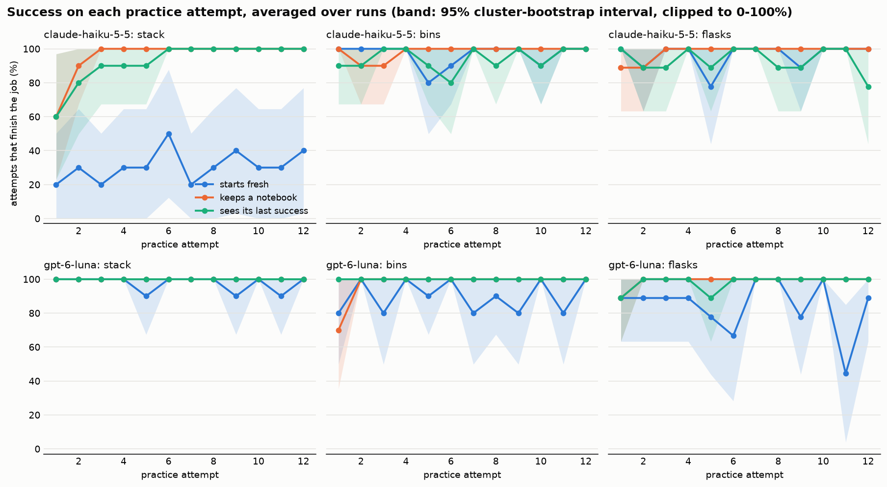
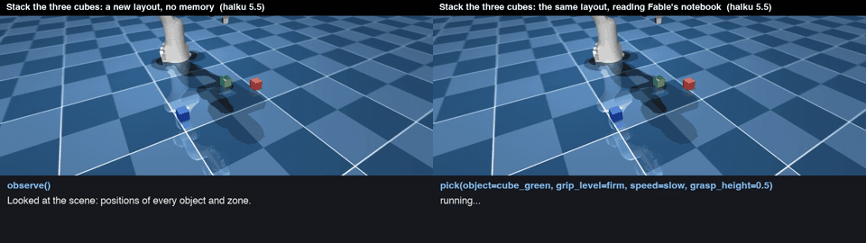
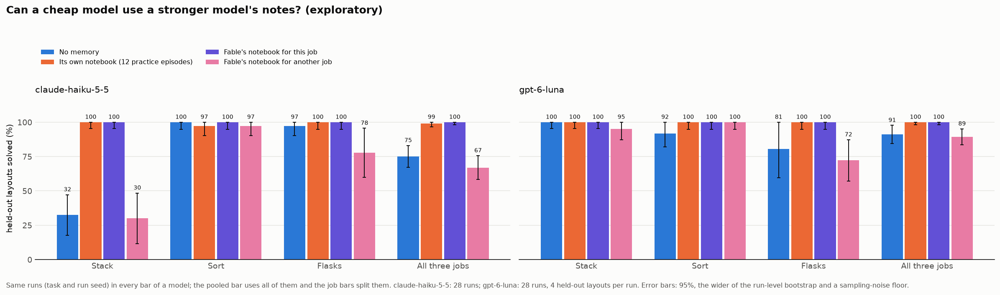

# robot-play

**Can an AI that only gives orders to a robot arm get better at a job just by practising it?**

Picture a new worker in a workshop. On day one they do not know that one drill sticks, or that one shelf is too tall for the short ladder. They find out by trying, they write a note, and by day ten they are faster and make fewer mistakes. Nobody retrained them. They just remembered.

This project asks whether a language model can do the same thing with a simulated robot arm. The model never touches the arm's motors. It calls simple tools such as `pick` and `place`, and ordinary robotics code (inverse kinematics and collision-free motion planning) does the careful movement behind them. Each job hides one small physical "catch". We watch whether the model finds the catch, writes it down, and uses it next time.

> **Status: all cells have finished (the registered matrix on 17 Nov at 01:26, the exploratory controls by 02:21).** Every number below comes from [results/RESULTS.md](results/RESULTS.md), which `scripts/analyze.py` regenerates from the raw run files; those files are in [data/](data/README.md) (7.7 MB) so you can regenerate the report yourself. The plan that was written before the runs is [PROTOCOL.md](PROTOCOL.md), the list of things that went wrong or changed is [results/deviations.md](results/deviations.md) (six entries), and [results/code_versions.md](results/code_versions.md) says which code produced which folder.

**The short version.** A notebook made the weaker models better where they had room to improve, and that gain survived a rerun on a corrected simulator with fresh layouts. What the notebook adds is less than it looks. One sentence naming the fixing setting did exactly as well as the notebook (at a 100% ceiling). A one-sentence tip that only *lists* the adjustable settings, without saying which one, recovered 40 of the 50 points on the one cell with room; I had predicted at most 60% for it, so **that prediction was missed, and the rule I wrote in advance for that outcome says the headline is weakened**. Notes written by a stronger model worked without the weaker model practising; a notebook written with no practice did not. For these jobs practice is a way to find one setting. It did not measurably help recovery from mid-task disturbances, though that test had little room to show an effect.

## What we found

**1. A notebook made the weaker models better where they had room to improve, and cut the calls they needed.** The registered comparison (10 runs per job, 4 unseen layouts per run, memory frozen, each model using its **own** notebook) gives:


| model | success with its own notebook | success starting fresh | difference (97.5% interval) |
|---|---|---|---|
| Claude Haiku 5.5 | 99% | 76% | **+23.3 points** (+14.0 to +32.6) |
| GPT-6 Luna | 100% | 91% | **+8.6 points** (+1.2 to +16.0) |

**How much to trust that, in plain words.** Findings 2 to 4 below say what the gain consists of and whether it replicates. Almost all of Haiku's gain is one cell, the `stack` job (32% to 100%). In the other five cells the fresh agent already solved at least 81% (Luna on `flasks`: 81% fresh, 100% with a notebook, 36 held-out episodes each, so a wide interval) and mostly 92% to 100%, so there was little room in success rate; there the benefit shows up as fewer calls. Luna's pooled interval only just clears zero, and my simulation of the interval rule (one scenario with stated independence assumptions) says it covers the truth about 96% of the time for a model this close to the ceiling, not the nominal 97.5% ([results/coverage_sim.md](results/coverage_sim.md)).

**2. A bug in my simulator touched the headline cell, but the same comparison on the corrected simulator with fresh layouts gives the same answer.** When Haiku's first grab on `stack` failed, the hand stayed closed. The next move planned its path as if the hand were open, so it landed on the cube and still answered "ok", and a later `close_gripper` could report `holding` with nothing in the fingers. In the no-memory runs 25 of the 27 failed held-out episodes contained one of those two wrong answers, against none of the 80 notebook and replay episodes. I rebuilt the layer that caused it and then repeated the registered comparison on **fresh layouts** (run seeds 20 to 29, both models, all three jobs, 2,400 episodes, [results/RESULTS.md](results/RESULTS.md) section 6c), with four predictions written down before it ran:

| corrected simulator, fresh layouts | with notebook | no memory | difference (95% interval) |
|---|---|---|---|
| Haiku, all three jobs | 100% | 78% | **+21.7 points** (+14.1 to +29.2) |
| Haiku, `stack` only | 100% | 50% | +50.0 points (+31.1 to +68.9) |
| Luna, all three jobs | 100% | 91% | **+9.2 points** (+3.6 to +14.7) |

All four predictions were met (the replication's predictions were written after the earlier results were known, so they are predictions about a replication and not independent forecasts), and the registered pooled gains (+23.3 and +8.6) sit inside these intervals. The false-`holding` and short-move symptoms are now zero in all 480 held-out episodes of the replication. **What the bug did and did not do:** on the same ten run seeds, three simulators gave Haiku `stack` gains of +67.5 (as registered), +60.0 (symptom fixed) and +47.5 points (cause fixed, interval +17.8 to +77.2). That 20-point drop is **not** shown to be the bug's doing: its paired interval is −14.6 to +54.6, the no-memory arm only moved from 13 to 15 to 17 of 40 (inside rerun noise), and half of the drop is one notebook run (run seed 5) that got 0 of 12 in practice and wrote "pick fails. Do not use pick" (a prediction that the notebook arm would stay at 95% or more on the corrected simulator therefore missed: 90%, recorded as missed in [PROTOCOL.md](PROTOCOL.md)). The pooled headline does not depend on the bug; the exact size of Haiku's `stack` gain in the registered run (+67.5) may be a little high, since fresh layouts gave +50.0.

**3. One sentence can replace the notebook, and a sentence that only lists the settings gets most of the way (exploratory, registered first; one prediction met, two missed).** A reader's first question is what a notebook actually adds. I ran the same held-out layouts with no practice at all and a different thing in the memory slot: (a) one sentence **naming** the fixing setting (for `stack`: "Pick the green cube with grip_level firm."), (b) one **generic** sentence, the same for every job: "Defaults do not suit every object or surface. When a pick or place fails or is refused, read the message and change the settings (grip_level, grasp_height, release_height, speed) one at a time instead of repeating the same call." It lists four adjustable settings, which include each job's fixing one, but never says which to change or to what value, so it is a shortlist plus permission to vary and **not a placebo**, and (c) a notebook that Fable wrote **with zero practice** from the task text and tool descriptions. Held-out success, run seeds 20 to 29, 30 runs per model, 4 layouts each:

| what the model reads (no practice unless stated) | Haiku, `stack` (10 runs) | Haiku, all three jobs | Luna, all three jobs |
|---|---|---|---|
| nothing | 50% | 78% | 91% |
| Fable's notebook written with zero practice | 65% | 87% | 89% |
| one generic sentence listing the settings | 90% | 91% | 93% |
| one sentence naming the fix | **100%** | **100%** | **100%** |
| its own notebook after 12 practice episodes | **100%** | **100%** | **100%** |

- **H1, met: the naming sentence is as good as the notebook.** The difference to the model's own notebook is 0.0 points (Haiku pooled, interval −2.3 to +2.3), and it needs fewer calls (7.5 against 9.8 pooled). Both arms sit at a 100% ceiling, so this says "one sentence is sufficient to match the notebook", not that the notebook contains nothing else: with its own notebook Haiku did not set the firm grip at all in 12 of 40 `stack` episodes and solved those 12 by turning the hand 45 degrees, always together with slow speed ([results/firm_grip_audit.md](results/firm_grip_audit.md); that combination was not tested by the one-setting-at-a-time audit, which found the turn alone works in 10 of 20 scripted layouts).
- **H2, MISSED: the generic sentence did not stay well below the notebook.** I predicted Haiku `stack` at most 60% and a pooled gain under +10 points; it reached 90% (+40.0 over fresh, interval +15.9 to +64.1) and the pooled gain was +12.5 (+3.4 to +21.6), exactly 10.0 points below the notebook on `stack` (−10.0, −20.8 to +0.8). The rule written in advance for this outcome says the headline is weakened: **a large part of the notebook's gain on `stack` is reproduced by a sentence that only lists the settings.** The logs show how ([results/firm_grip_audit.md](results/firm_grip_audit.md)): with no memory Haiku set the firm grip in 21 of 40 `stack` episodes and, in the 15 episodes that used neither the firm grip nor the hand turn, solved 2; with the generic sentence it set the grip in 35 of 40; with the naming sentence in 40 of 40.
- **H3, half missed: a notebook written without practice does not find the fix.** I predicted that the zero-practice notebooks would name the fix for `stack`; none of the 30 does (they list settings as things to check and say to start with the defaults; [results/prior_notebook_audit.md](results/prior_notebook_audit.md)). Haiku with one solved 65% on `stack` (the success part of the prediction, at least 60%, was met): +15.0 over fresh with an interval that includes zero (−7.6 to +37.6), and 35 points below its own notebook.

So *finding* the setting is what practice (or a writer who has practised) supplies, and *trying* settings is largely what a shortlist supplies. Luna has little room (98% fresh on `stack`), so its rows differ by a few points. Caveats: the prompt label differs between arms ("a hint from an experienced operator", "a notebook written by a more capable assistant"), so content and label are not separated, and I did not run a label-matched or a true-placebo arm; the naming sentence is an answer key by construction and says nothing about whether a model can find the fix; each catch in these jobs is one constant, which makes "practice finds one setting" partly a property of the task design; only Haiku on `stack` has real room, so the pooled rows are that cell diluted; and ten runs per job is few.

**4. A mid-tier writer is enough: Claude Sonnet 5.5's notebook worked for the cheaper models with no practice of their own (exploratory, registered after the hint result was known; three of four predictions met, one not testable).** Fable was the only writer behind the borrowed-notebook result and it never failed a practice episode, so I repeated it with Sonnet 5.5, which does fail some (7% of its `stack` practice episodes). Sonnet practised for 12 episodes and wrote its own notebook on 20 runs (`stack` run seeds 20 to 29, `bins` and `flasks` 20 to 24) and solved 100% of its held-out layouts; 9 of its 10 `stack` notebooks name the firm grip, all 10 `bins` and `flasks` notebooks name theirs. Haiku reading Sonnet's notebook with no practice solved 100% on all three jobs (20 runs), against 71% fresh (**+28.7 points**, +18.6 to +38.9) and 100% with its own notebook (0.0, −3.4 to +3.4); on `stack` 100% against 50%. Luna went from 94% to 100% (+6.2, +0.1 to +12.4). Reading Sonnet's notebook, Haiku set the firm grip in 36 of its 40 `stack` episodes and turned the hand 45 degrees in the other 4 ([results/firm_grip_audit.md](results/firm_grip_audit.md)); with its own notebook it used the turn alone in 12 of 40, so the two notebooks point to different routes that both work. **The fourth prediction could not be tested**: it asked whether a stronger writer repairs a run where Haiku's own notebook locked in a wrong rule, and none of Haiku's 30 own-notebook runs in this replication failed. This is a second writer, not a general statement about writers (both are Anthropic models), and because I registered it after the naming hint had already reached 100%, two of its predictions were close to certain when written; Sonnet's own results are also at a 100% ceiling.

**5. The frontier models left no room, so a cheap model with a notebook matched them on these jobs at a fraction of the price; this is a ceiling result.** On the same 60 layouts Claude Fable 5.2 and GPT-6 Astra each solved 60 of 60 on their first try, so this task set cannot separate them from anything that also solves it. With a notebook Haiku solved 98% (gap +1.7 points, 98.75% interval −7.3 to +10.5) and Luna 100% (gap 0.0, interval −6.9 to +6.9). The plan said "close" means the whole interval stays under +10 points: **that holds for Luna and narrowly fails for Haiku** (its upper end is 10.5). The money for those same 60 layouts, estimated from price lists (Anthropic's checked against its documentation, OpenAI's **not** verified): Fable $3.58 and Astra $5.79 for the first try, against $0.38 for Haiku and $0.28 for Luna including all 12 practice episodes and notebook rewrites, between about 9 and 21 times cheaper depending on the pair. The ratio depends on how many practice episodes it is spread over and says nothing about harder jobs; every model ran at the same low reasoning effort. Given finding 3, the cheap models' gain here is mostly the gain of being told which setting to change.

**6. The cheap models needed fewer calls with a notebook, pooled over the jobs.** This measure charges a failed episode the full 20 calls, so it mixes speed with success and is not a measure of elapsed time. Haiku needs 15.6 calls fresh and 9.9 with a notebook (−5.7, 95% interval −6.5 to −4.9); Luna needs 12.1 and 8.1 (−4.0, −4.9 to −3.2). A last-success replay (the model just sees its previous successful run) needs about as many calls as a notebook for Haiku (10.4 against 9.9) and clearly more for Luna (9.3 against 8.1).



On practice attempt 1 the three memory arms have the same information, since nothing has been remembered yet, so the gaps there (for example Haiku `stack` at 20%, 60% and 60%) show how far a ten-run cell can move from run-to-run variability. These are outcomes on practice layouts, not a held-out learning trajectory.

**7. A stronger model's notes help a weaker one, and one episode of expert practice was enough on these layouts (exploratory).** I gave each cheap model, with no practice of its own, the notebook that Fable wrote after practising the same job. On the 28 runs where all four arms exist, Haiku solved 100% of the held-out layouts with Fable's notebook, against 99% with its own notebook and 75% fresh, in 7.2 calls against 9.7 and 15.5. A notebook from a *different* job did not help: Haiku fell to 67%, which is 8.0 points below starting fresh (95% interval −19.8 to +3.7, so not distinguishable from no effect), driven by `flasks` (28 of 36) rather than the headline job. That control is suggestive and not clean, because the prompt also tells the model the notebook is for another task, so the instruction and the content change together. Fable's notebook after just **one** practice episode gave the same 100% on the same 29 finished runs; that is one writer, one task set and the registered (defective) simulator, not a general statement that one episode suffices. **On cost, the case is weaker than the success rate suggests.** Fable's twelve-episode notebook costs about $1.40 once and the one-episode version about $0.13. It pays for itself after about 24 episodes **only if the alternative is running Fable on every episode**; against a cheap model keeping its own $0.03 notebook it takes about 5,300 episodes for Haiku and never for Luna, so the reason to borrow is speed (fewer calls), not money.

*The clip below is the borrowed arm (Haiku reading Fable's notebook), 3x speed, same layout and model on both sides. Left, no memory: the model never switches to a firm grip (one default-grip `pick` did report `holding` and the tower still did not get finished) and never finishes. Right: it grips firmly and finishes in 5 of 20 calls. Both episodes are free of the simulator bug's two wrong answers.*



The full-length videos are [no memory](media/claude-haiku-5-5-stack-layout20000-no-memory-c2.mp4) (70 s) and [with Fable's notebook](media/claude-haiku-5-5-stack-layout20000-fable-notebook-c2.mp4) (25 s).



**8. Practice did not measurably help recovery from a disturbance (confirmatory in the no-catch scenes: no evidence of an effect).** In the no-catch control scenes the object slips out of the gripper 3 cm into the lift, or gets a sideways shove. There both conditions solve the clean layouts about equally often, so the drop caused by the disturbance is a fair measure. Haiku with a notebook lost 3 points and fresh lost 6 (difference −2.6, 97.5% interval −9.8 to +4.6); Luna lost 4 with a notebook and 3 fresh (+0.9, −6.3 to +8.1). Both intervals include zero, which is what the plan said would count against the claim "experience helps recovery". **This test had little room:** fresh agents kept 94% and 96% of their clean success under disturbance, so even a notebook that removed the whole drop would have gained only 6 and 3 points, less than the interval's half-width (about 7), and "no evidence of an effect" is all it says. In the catch scenes (exploratory) notebook agents lose 3 points to the disturbance and fresh agents lose 10 (Haiku) and 16 (Luna); the difference in drops is −6.9 points for Haiku (95% interval −19.4 to +5.6) and −12.1 for Luna (−22.3 to −1.9), but a fresh agent that already fails the clean layout cannot drop, so those rows mostly reflect clean-success ceilings. On the three simulators Haiku with no memory solved 14, 14 and 7 of 40 disturbed `stack` layouts (registered, symptom fixed, cause fixed) and with a notebook 40, 36 and 36.

*Selected example, not a typical one: Haiku with a notebook on `stack`, where a shove knocks the cube sideways mid-task and the model re-grasps it. [Video](media/claude-haiku-5-5-stack-eval_disturbed1-d3.mp4).*

**9. Without `pick` and `place` the models can still do the jobs, and a notebook still helped (exploratory, 9 runs per model).** With only `move_to` and the gripper and three times the call budget, Haiku solved 75% fresh and 89% with a notebook (36 episodes each; calls to success 38.7 and 27.2) and Luna 50% and 86% (42.2 and 26.5). Luna fresh looks cheap in raw calls only because it said "done" falsely in 18 of its 36 episodes, every one of its failures. Luna's notebook gain is +36.1 points (+11.6 to +60.6) and Haiku's +13.9 (−3.8 to +31.5); whether the gain is larger or smaller than with the skill tools cannot be told from nine runs (differences −11.1 and +27.8 points, both intervals include zero).

## What this does not show

- **It is a simulation.** Nothing here says a real arm would behave the same way. A physical version is future work.
- **Most of the room to improve was in one cell.** The headline gain is Haiku on `stack`. The other five model and job cells were at 81% or more already, most at 92% or more (the replication found some room for Luna on `flasks`, +17.5 points, interval +4.8 to +30.2).
- **My simulator had a bug that hit the no-memory runs of the headline cell much harder than the notebook runs.** I found it, fixed it, and report the registered result, three simulators and a fresh-layout replication above. The registered numbers still use the defective simulator and the replication is exploratory by design, so it does not replace them; it agrees with them pooled.
- **A self-written notebook can lock in a wrong rule.** On the corrected simulator one of the ten Haiku `stack` runs of the three-simulator test wrote "do not use `pick`" after twelve failed practice episodes and then failed every held-out layout. It did not happen in the 30 own-notebook runs of the fresh-layout replication, or in the 20 registered-simulator Haiku `stack` runs (run seeds 0 to 19); [PROTOCOL.md](PROTOCOL.md) v1.8 prediction 4 (does a stronger writer repair such a run?) could not be tested for that reason. The notebook is only as good as the practice that wrote it.
- **Two writers, both of which mostly succeed.** The "stronger model's notes" results use Fable (it never failed a practice episode) and Sonnet 5.5 (it failed 7% of `stack` practice episodes). Neither shows what a notebook written after many failures looks like when it is right, and neither says anything about writers from other families.
- **The hints and the zero-practice notebook differ from the notebook in their wording as well as their content.** Each arm tells the model something different about where the text came from, so these controls cannot separate the content from the label. The naming hint is an answer key by construction. Ten runs per job is few for the per-job rows.
- **Luna's registered gain sits near the edge** (97.5% interval +1.2 to +16.0, coverage about 96%); the replication gives +9.2 (+3.6 to +14.7).
- **Same low reasoning effort everywhere.** A frontier model allowed to think longer might also fix the catch in one attempt, which would change the cost comparison.
- **29 of 30 runs per condition in the registered cells, not 30.** One planned layout (flasks, evaluation seed 20801) could not be built by the original layout sampler, so the flasks run with run seed 8 stopped there and is left out of every registered condition. That leaves 29 of the 30 (job, run seed) runs per model and condition that a pooled number uses (and 9 of 10 for flasks alone). The sampler now restarts when it paints itself into a corner (a test checks that every planned layout of run seeds 0 to 29 can be built); the replication and the later cells use it and have all 30.
- **The notebook keyword audit is outcome-informed** ([results/notebook_audit.md](results/notebook_audit.md)): I looked for the fixing setting after seeing that it mattered, so it shows the notebooks contain the fix, not that they were the cause.
- **Two things went wrong during the run and are on the record** ([results/deviations.md](results/deviations.md) 5 and 6): a merge briefly deleted the model directory (72 empty run files moved aside; 14 further files with an outage abort record were kept and resumed, three of them after 1 to 2 episodes had been played) and orphaned workers wrote repeated episodes into 8 replication files (the 8 runs were played again). `scripts/check_run_files.py` finds repeated or out-of-order episodes and header-less files, and with `--expect` unexpected code hashes; every folder passes it.

## The three jobs

Each job has one physical catch. The catch is not stated anywhere the model can read. The model has to notice what the simulator reports and change how it acts.

| Job | The catch | Can the model see it? | What a failure looks like | What fixes it |
|---|---|---|---|---|
| **Stack** three cubes into a tower | The green cube is heavy (250 g against 50 g) and slippery. A normal squeeze did not hold it in any of 100 test layouts. | **No.** Weight and friction are never shown. | The fingers close to 1.9 cm and the cube stays on the table. | A firm grip. |
| **Sort** four cubes into a red bin and a blue bin | The bin walls are 12 cm tall, higher than the hand can reach over when it lowers the cube. | **Partly.** The wall heights are in the observation. What they mean for the hand is not stated. | `arm/hand would touch bin_red_wall2` | Letting go from 14 cm up or higher. |
| **Stand** two flasks upright on rings | Each flask has a wide base (10 cm) that the fully open hand (8 cm) cannot get around. | **Partly.** The flask sizes are in the observation. What they mean for the fingers is not stated. | `hand stopped 1.4 cm short of the requested grasp point` | Grabbing the narrow neck near the top (`grasp_height` 0.9). |

Every job also has a **control** version with no catch, so we can check whether a notebook helps where there is nothing to learn. That informs the question of where a gain comes from; it does not by itself prove the mechanism.

These clips are me playing each job by hand, using only the tools and the numbers an AI would get (the full transcripts are in [docs/TASKS.md](docs/TASKS.md)). I failed the first attempt in each one, read the measurements, and fixed it.

| Stack | Sort | Stand up |
|---|---|---|
|  |  |  |
| [full video](media/stack_seed11-v2.mp4) | [full video](media/bins_seed5-v2.mp4) | [full video](media/flasks_seed7-v2.mp4) |

## How an AI drives the arm

The model gets eight tools, one call per turn, so each call sees the result of the one before it. No tool description mentions a catch, and every result is a measurement, never an explanation.

- **`observe`** shows where every object and zone is.
- **`pick`** moves above an object, goes down, squeezes, and lifts. You can choose where on the object to grab (`grasp_height`), how hard to squeeze (`grip_level`), how fast to move (`speed`), how far to lift (`lift_height`) and how far to turn the hand (`yaw_offset_deg`).
- **`place`** carries the held object to a target, lowers it, lets go, and backs off. You can choose how high above the surface to let go (`release_height`), the speed and a pause (`settle_time`).
- **`move_to`**, **`open_gripper`**, **`close_gripper`**, **`home`** are the basic moves.
- **`done`** ends the episode. The simulator then decides whether the job was really finished. The model's own claim is recorded separately so we can count how often it says "done" when it is not: 1 to 2% of the clean held-out episodes with the skill tools (50% of Luna's pose-level fresh episodes, finding 9), but in the **disturbed** ones GPT-6 Luna with no memory said "done" falsely in 22 of 116 (19%) against 3 of 116 with a notebook (over all held-out catch-scene episodes Luna 32 of 580, Haiku 9 of 580; [results/RESULTS.md](results/RESULTS.md) section 8).

The model has 20 tool calls per episode, so wasting calls on discovering a catch costs it. Each run is 12 practice episodes (the memory is built here), 4 held-out episodes on layouts it has never seen (memory frozen), and four more held-out episodes with a mid-task disturbance (none and notebook arms). There are three memory conditions: none, a **notebook** (the model rewrites its own notes after each practice episode), and a **replay** (it sees its last successful run). There is also a **pose-level version** with no `pick` and `place`, where the model builds them from moves and the gripper, with three times the call budget. Comparing the two is exploratory, because the budget and the planner's feedback differ too.

## How we know the jobs are fair

A badly made job would give meaningless results. So before any AI is allowed near them, the jobs pass these checks. All of them are played through the same wrapper the AI uses, with the same 20-call budget. The tables below are from the registered code. I reran all five checks on the corrected code and they pass with no crashed runs, with identical tables except one mean-calls figure in the pose gate ([results/fixed_code/](results/fixed_code/README.md)).

**1. A script that knows the answer always wins, and one that does not always loses** (100 random layouts per row, `python scripts/gate.py`).

| Job | Scene | A script using default settings | A script that knows the catch |
|---|---|---|---|
| Stack | with the catch | 0 / 100 | 100 / 100 |
| Stack | control | 100 / 100 | 100 / 100 |
| Sort | with the catch | 0 / 100 | 100 / 100 |
| Sort | control | 99 / 100 | 100 / 100 |
| Stand up | with the catch | 0 / 100 | 100 / 100 |
| Stand up | control | 100 / 100 | 100 / 100 |

**2. The catch switches on gradually.** For example, a green cube of 150 g is still fine with default settings, and at 250 g it never works.


**3. We know which settings matter** ([full table](results/settings_audit.md), 20 layouts per cell). Changing one setting at a time from its default, one setting rescues each catch every time: a firm grip for the stack (20 of 20), letting go from 14 cm or higher for the sort (20 of 20), and a high grasp for the flasks (20 of 20). Speed, lift height and the pause after letting go never rescue a catch, and fast placing even lowers success in the no-catch scenes. Turning the hand 45 degrees also builds the tower about half the time with the default grip (10 of 20), so for the stack the firm grip is the reliable fix and not the only one. We do not call any setting a harmless decoy.

**4. The disturbances work**, in the catch scenes ([table](results/disturbance.md)) and in the no-catch control scenes ([table](results/disturbance_control.md)), 50 fresh layouts per row, not the layouts the nudge was tuned on. Both the slip and the shove happened in every episode. A script that knows the catch but does not react never recovered (0 of 50 in every row). A script that tries again recovered in 47 to 50 of 50.

**What this does not prove.** It proves the jobs can be solved, are failed by default settings, and respond to the catch. It does not prove that a language model can learn the catch. That is what the experiments are for.

## What was run

The registered cells (main, control, frontier) were fixed in advance in [PROTOCOL.md](PROTOCOL.md), including the result that would count against each claim. Everything added or changed after the launch is dated to the minute, labelled exploratory where it is, and explained in [results/deviations.md](results/deviations.md) (one analysis rule was tightened after the first half of one cell had been seen, which is disclosed there).

| Cell | What it is | Status |
|---|---|---|
| main | 2 cheap models x 3 jobs x {none, notebook, replay}, run seeds 0 to 9 | **confirmatory** (Q1, Q3) |
| control | the same without the catch, with disturbances | **confirmatory** (Q4); 116 of 120 episodes per cell (the flasks run-seed-8 layout) |
| frontier | Fable and Astra first tries, no memory, 20 layouts per job | confirmatory (Q3) |
| frontier_exp | Fable with its own notebook (the source of the borrowed notebooks) | exploratory |
| borrowed (4 variants) | cheap models read Fable's notebook (12, 3 or 1 practice episodes, or the wrong job's notebook) | exploratory |
| main_ext | Haiku on stack and bins, run seeds 10 to 19 | exploratory |
| three simulators | Haiku on stack on the registered, partly fixed and cause-fixed simulator | exploratory |
| corrected-simulator replication | the registered Q1 comparison on fresh layouts, run seeds 20 to 29, 2,400 episodes | exploratory, complete |
| hint, generic hint, zero-practice notebook | no practice; one naming sentence, one generic sentence, or a Fable notebook written without practice; run seeds 20 to 29, 720 episodes | exploratory, complete |
| second writer | Sonnet 5.5 practises and writes a notebook (320 episodes); Haiku and Luna read it with no practice (160 episodes) | exploratory, complete |
| pose | the same runs with pose-level tools (pick/place removed), run seeds 0 to 2 | exploratory, complete |

The money is capped in code by an *estimate*: before every call the worst case is reserved, a call that would pass the cap is refused, and Anthropic stops at $90 and OpenAI at $45 (of $100 and $50). The cap counts failed retries and notebook-writing calls too. It is not an invoice audit: Anthropic's prices were checked against its own documentation, OpenAI's were not, and the ledger should be compared with both billing consoles. Final spend by that estimate: $72.05 (Anthropic) and $26.03 (OpenAI).

Every interval is the wider of a cluster bootstrap over runs (a task and run seed share one memory), a stratified t interval, and a binomial sampling-noise floor, because an interval from ten runs that all agree would otherwise have zero width. I checked how often that rule covers the truth by simulation ([scripts/coverage_sim.py](scripts/coverage_sim.py)): 97.5% to 100% in most of the scenarios I simulated and 95.8% in the worst one (a Luna-like ceiling case); the simulations assume independent episodes within a run and a beta mixture of run-level success rates, and the Monte Carlo standard error is about 2.5 points. I recomputed the headline numbers a second way, straight from the raw files ([scripts/recompute_headlines.py](scripts/recompute_headlines.py)), and they match.

## Run it yourself

```bash
uv sync --extra dev                      # installs MuJoCo 4.0.1, the pinned packages from uv.lock and pytest
bash scripts/fetch_models.sh             # downloads the Franka Panda model at the pinned revision
.venv/bin/python -m pytest -q            # the automated tests (no network, no money)
.venv/bin/python scripts/play.py start stack 11
.venv/bin/python scripts/play.py call pick '{"object": "cube_green"}'
.venv/bin/python scripts/gate.py --seeds 100     # the fairness checks (about 6 minutes)
.venv/bin/python scripts/audit_settings.py       # the settings audit
# with ANTHROPIC_API_KEY / OPENAI_API_KEY set (this spends money, behind the spend cap):
.venv/bin/python scripts/smoke.py --model claude-haiku-5-5 --task stack
.venv/bin/python scripts/run_experiment.py --cell main --models claude-haiku-5-5 gpt-6-luna --seeds 0-9 --out runs/main
.venv/bin/python scripts/analyze.py      # writes results/RESULTS.md and the learning-curve chart
```

**Which revision gives which numbers.** `main` is the corrected simulator plus every exploratory switch. The registered results (main, control, frontier) were produced by the revision tagged `matrix-launch`, which has the simulator defect of finding 2; check that tag out to repeat them. The replication and the gates on corrected code used `code-fixed`, the hint cells and the second writer used `code-hint-prior` (equal to `main` for everything the code hash covers). [results/code_versions.md](results/code_versions.md) lists every tag with its hash. **No network, no money:** the raw run files are in [data/](data/README.md), and a recipe there regenerates `results/RESULTS.md` from them byte for byte; `scripts/check_run_files.py runs/*` checks them for repeated or out-of-order episodes.

`play.py` lets you play a job yourself through the exact tools an AI gets. Try the default `pick` on the green cube first.

## What is already known in this area

Several papers study parts of this ([PROTOCOL.md](PROTOCOL.md) section 9 has the full table): [RoboARCade](https://arxiv.org/abs/2611.08209) (in-context improvement from one example demo in MuJoCo, and false success claims), [WICL / RoboScript](https://arxiv.org/abs/2611.12885) (a frozen task memory learned in simulation), [GPT-Policy](https://arxiv.org/abs/2609.19138) (a model calling IK-backed tools on real robots), [PhysMem](https://arxiv.org/abs/2602.20323) (an AI building and testing guesses about hidden physics while it works, the closest), [Act-Observe-Rewrite](https://arxiv.org/abs/2603.04466) and [PhysCaP](https://arxiv.org/abs/2608.21031) (exploring to find hidden masses). We do not claim any one of those ideas as new, and the in-context memory idea itself comes from Voyager, ExpeL and Reflexion. What this project adds is a set of controls on one such memory: the same jobs through skill-level and pose-level tools, catches proved by validation, held-out layouts, a hint control and a second writer that ask what a notebook actually carries, and recovery from mid-task problems. The most useful single finding is a negative one: for jobs whose catch is one constant, the notebook is mostly a way to find that constant.

## Not done

- The real SO-101 arm, and any transfer from this simulator to hardware.
- Jobs hard enough that frontier models fail their first try. On these jobs they solve 60 of 60, so the frontier comparison is a ceiling result and the cheap-versus-frontier question is open for harder tasks.
- A frontier model at higher reasoning effort, and writers from other model families than Fable and Sonnet.
- A rerun of the whole registered matrix on the corrected simulator. Only the Q1 comparison was repeated there (and Q3 was not).
- A cleaner test of what the notebook carries: the arms differ in wording as well as content, ten runs per job is few, and nothing here tests whether a model can find the fix without practising other than by reading a notebook.
- Pose-level conclusions: the pose cell is small (3 runs per job and model) and had tool caveats of its own.

## Folder map

See [docs/FOLDERS.md](docs/FOLDERS.md).
