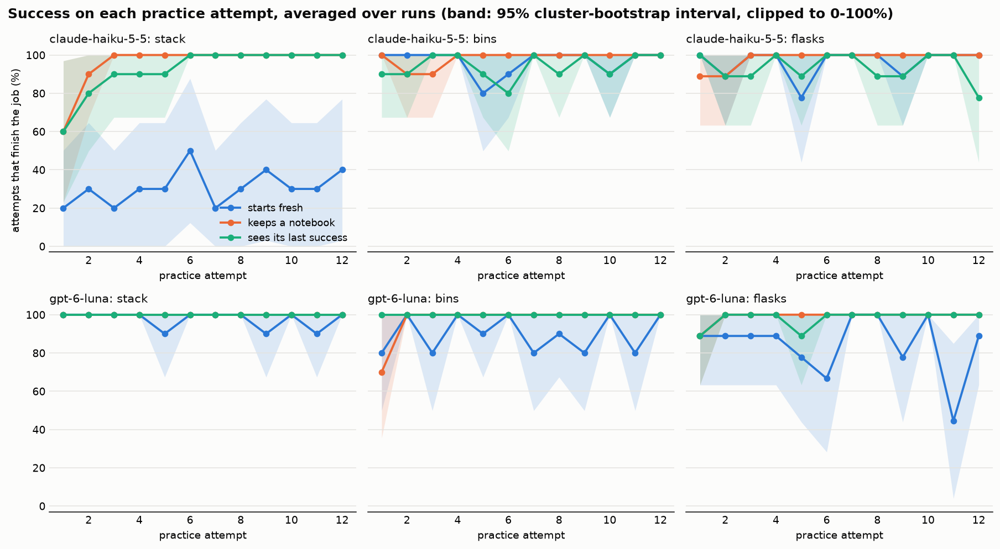
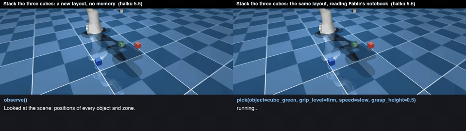
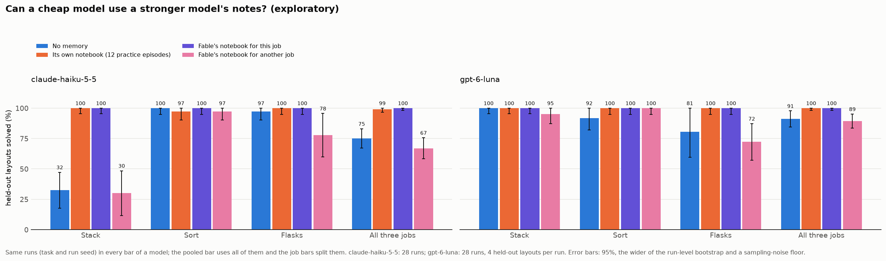

# Other findings

These five results from the [README](../README.md) are kept here so the README fits on a screen. Everything is generated by `scripts/analyze.py` into [results/RESULTS.md](../results/RESULTS.md); the registered ones are marked as such. Letters A to E are the old README numbers 5 to 9.

**A. The frontier models left no room, so a cheap model with a notebook came close to them on these jobs at a fraction of the price; this is a ceiling result.** On the same 60 layouts Claude Fable 5.2 and GPT-6 Astra each solved 60 of 60 on their first try, so this task set cannot separate them from anything that also solves it. With a notebook Haiku solved 98% (gap +1.7 points, 98.75% interval −7.3 to +10.5) and Luna 100% (gap 0.0, interval −6.9 to +6.9). The plan said "close" means the whole interval stays under +10 points: **that holds for Luna and narrowly fails for Haiku** (its upper end is 10.5). The money for those same 60 layouts, estimated from price lists (Anthropic's checked against its documentation, OpenAI's **not** verified): Fable $3.58 and Astra $5.79 for the first try, against $0.38 for Haiku and $0.28 for Luna including all 12 practice episodes and notebook rewrites, between about 9 and 21 times cheaper depending on the pair. The ratio depends on how many practice episodes it is spread over and says nothing about harder jobs; every model ran at the same low reasoning effort. [README finding 3](../README.md) says what the cheap models' gain consists of.

**B. The cheap models needed fewer calls with a notebook, pooled over the jobs.** This measure charges a failed episode the full 20 calls, so it mixes speed with success and is not a measure of elapsed time. Haiku needs 15.6 calls fresh and 9.9 with a notebook (−5.7, 95% interval −6.5 to −4.9); Luna needs 12.1 and 8.1 (−4.0, −4.9 to −3.2). A last-success replay (the model just sees its previous successful run) needs about as many calls as a notebook for Haiku (10.4 against 9.9) and clearly more for Luna (9.3 against 8.1).

On practice attempt 1 the three memory arms have the same information, since nothing has been remembered yet, so the gaps there (for example Haiku `stack` at 20%, 60% and 60%) show how far a ten-run cell can move from run-to-run variability. These are outcomes on practice layouts, not a held-out learning trajectory.

**C. A stronger model's notes help a weaker one, and one episode of expert practice was enough on these layouts (exploratory).** I gave each cheap model, with no practice of its own, the notebook that Fable wrote after practising the same job. On the 28 runs where all four arms exist, Haiku solved 100% of the held-out layouts with Fable's notebook, against 99% with its own notebook and 75% fresh, in 7.2 calls against 9.7 and 15.5. A notebook from a *different* job did not help: Haiku fell to 67%, which is 8.0 points below starting fresh (95% interval −19.8 to +3.7, so not distinguishable from no effect), driven by `flasks` (28 of 36) rather than the headline job. That control is suggestive and not clean, because the prompt also tells the model the notebook is for another task, so the instruction and the content change together. Fable's notebook after just **one** practice episode gave the same 100% on the same 29 finished runs; that is one writer, one task set and the registered (defective) simulator, not a general statement that one episode suffices. **On cost, the case is weaker than the success rate suggests.** Fable's twelve-episode notebook costs about $1.40 once and the one-episode version about $0.13. It pays for itself after about 24 episodes **only if the alternative is running Fable on every episode**; against a cheap model keeping its own $0.03 notebook it takes about 5,300 episodes for Haiku and never for Luna, so on these jobs the benefit of borrowing showed up as fewer calls, not money.

*The clip below is the borrowed arm (Haiku reading Fable's notebook), 3x speed, same layout and model on both sides. Left, no memory: the model never switches to a firm grip (one default-grip `pick` did report `holding` and the tower still did not get finished) and never finishes. Right: it grips firmly and finishes in 5 of 20 calls. Both episodes are free of the simulator bug's two wrong answers.*

The full-length videos are [no memory](../media/claude-haiku-5-5-stack-layout20000-no-memory-c2.mp4) (70 s) and [with Fable's notebook](../media/claude-haiku-5-5-stack-layout20000-fable-notebook-c2.mp4) (25 s).

**D. Practice did not measurably help recovery from a disturbance (confirmatory in the no-catch scenes: no evidence of an effect).** In the no-catch control scenes the object slips out of the gripper 3 cm into the lift, or gets a sideways shove. There both conditions solve the clean layouts about equally often, so the drop caused by the disturbance is a cleaner measure than in the catch scenes. Haiku with a notebook lost 3 points and fresh lost 6 (difference −2.6, 97.5% interval −9.8 to +4.6); Luna lost 4 with a notebook and 3 fresh (+0.9, −6.3 to +8.1). Both intervals include zero, which is what the plan said would count against the claim "experience helps recovery". **This test had little room:** fresh agents kept 94% and 96% of their clean success under disturbance, so even a notebook that removed the whole drop would have gained only 6 and 3 points, less than the interval's half-width (about 7), and "no evidence of an effect" is all it says. In the catch scenes (exploratory) notebook agents lose 3 points to the disturbance and fresh agents lose 10 (Haiku) and 16 (Luna); the difference in drops is −6.9 points for Haiku (95% interval −19.4 to +5.6) and −12.1 for Luna (−22.3 to −1.9), but a fresh agent that already fails the clean layout cannot drop, so those rows mostly reflect clean-success ceilings. On the three simulators Haiku with no memory solved 14, 14 and 7 of 40 disturbed `stack` layouts (registered, symptom fixed, cause fixed) and with a notebook 40, 36 and 36.

*Selected example, not a typical one: Haiku with a notebook on `stack`, where a shove knocks the cube sideways mid-task and the model re-grasps it. [Video](../media/claude-haiku-5-5-stack-eval_disturbed1-d3.mp4).*

**E. Without `pick` and `place` the models can still do the jobs; a notebook helped Luna clearly and Haiku by an amount that cannot be told from zero (exploratory, 9 runs per model).** With only `move_to` and the gripper and three times the call budget, Haiku solved 75% fresh and 89% with a notebook (36 episodes each; calls to success 38.7 and 27.2) and Luna 50% and 86% (42.2 and 26.5). Luna fresh looks cheap in raw calls only because it said "done" falsely in 18 of its 36 episodes, every one of its failures. Luna's notebook gain is +36.1 points (+11.6 to +60.6) and Haiku's +13.9 (−3.8 to +31.5); whether the gain is larger or smaller than with the skill tools cannot be told from nine runs (differences −11.1 and +27.8 points, both intervals include zero).
